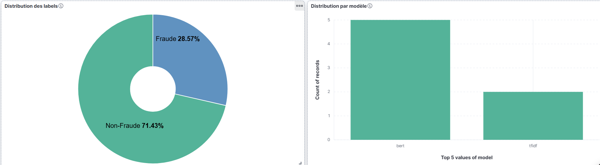
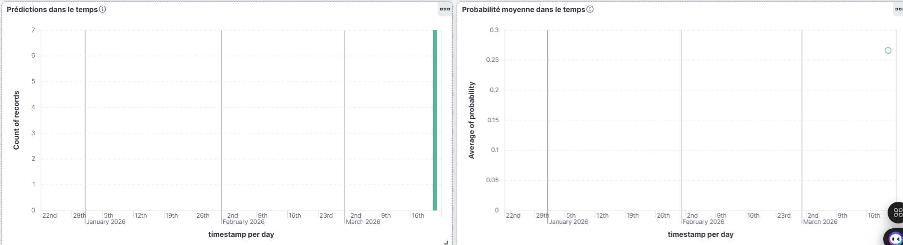
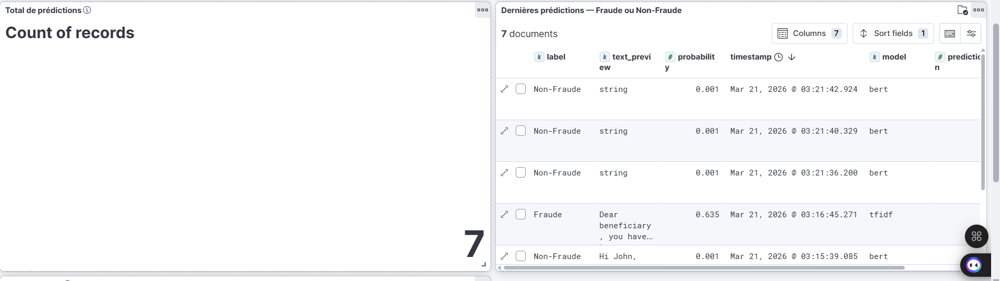
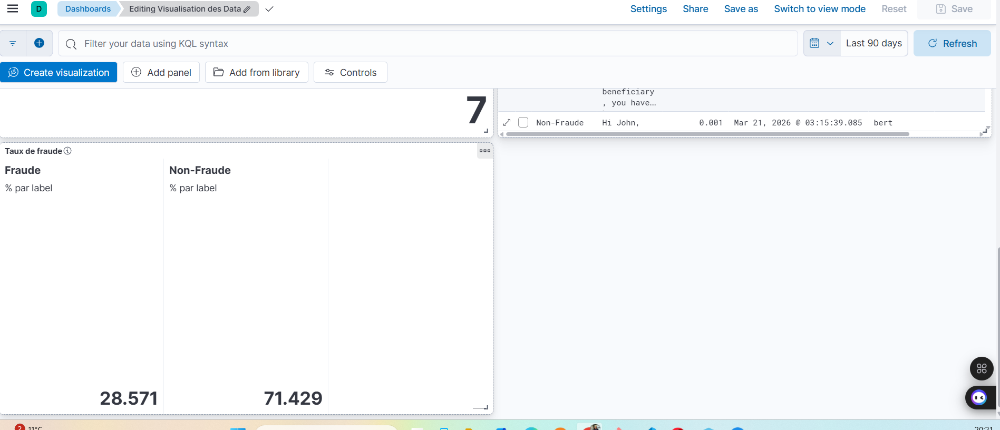
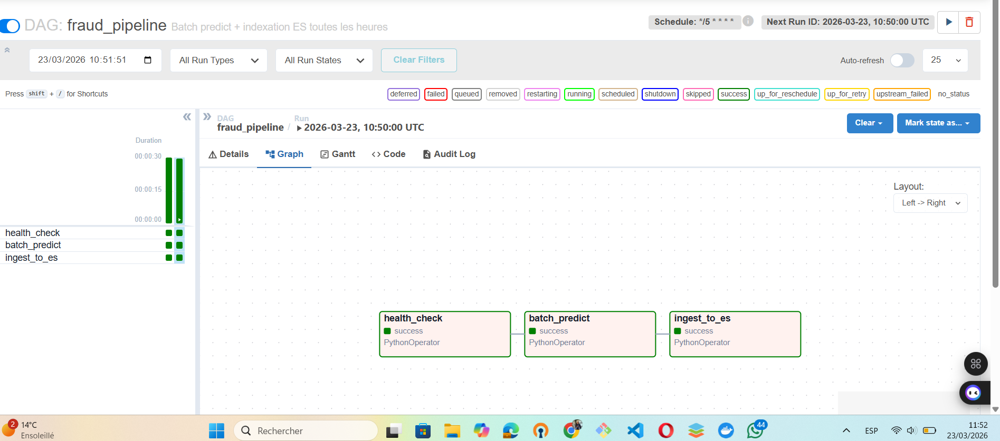
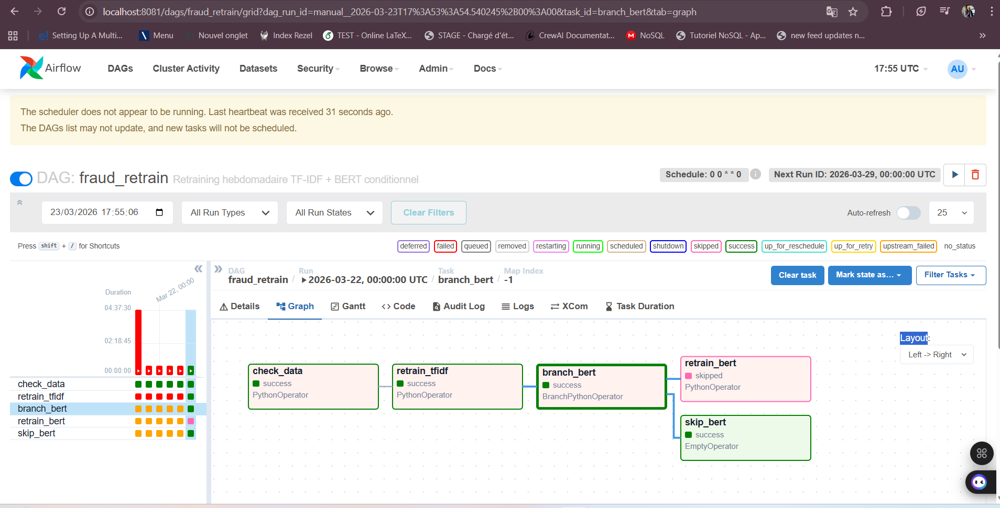
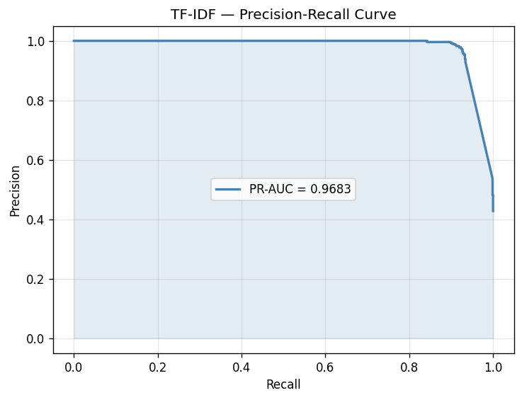
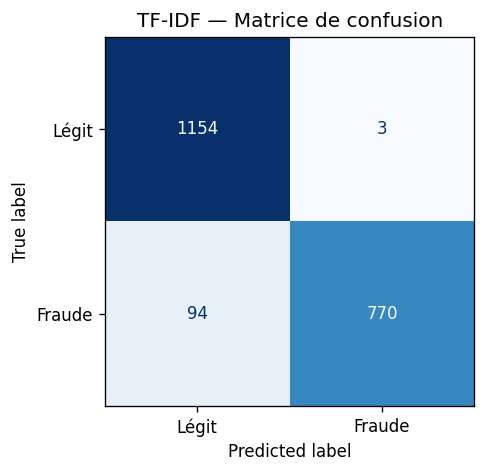
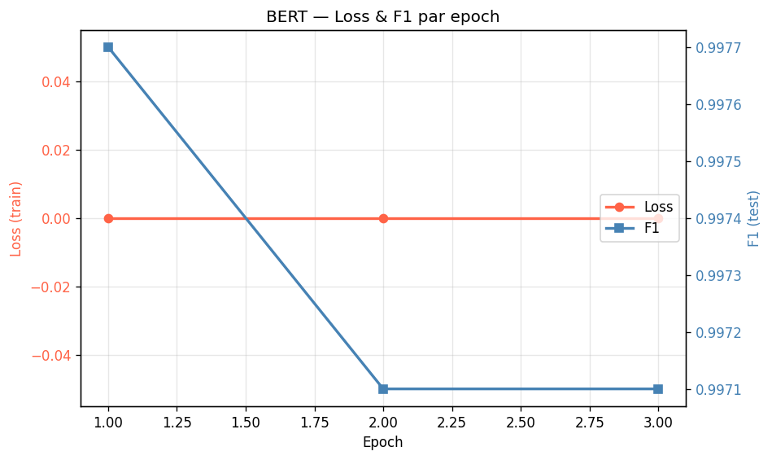
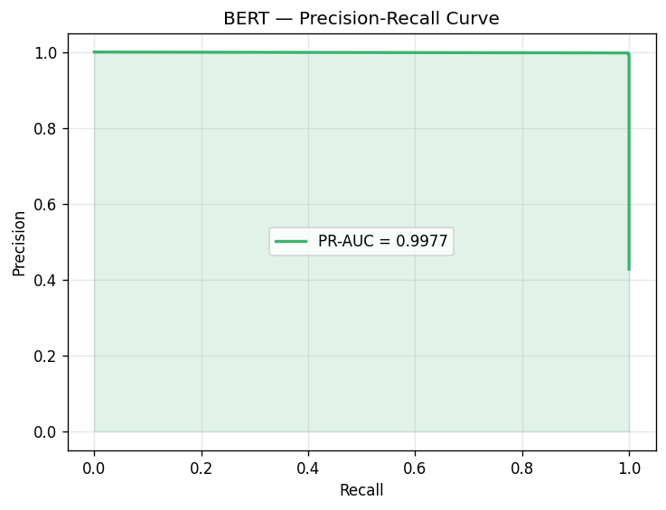

# Fraud Text NLP — Production-Ready Fraud Detection

Détection automatique d'emails frauduleux (phishing, scams) via un pipeline NLP production-ready.

## Stack technique

| Couche | Technologie |
|---|---|
| NLP | Python, scikit-learn, transformers (BERT) |
| Orchestration | Airflow (Docker) |
| Serving | FastAPI |
| Logging | Elasticsearch + Kibana |
| Experiment tracking | MLflow |
| Containerisation | Docker, docker-compose |
| Data | pandas, numpy |

---

## Dataset

- **Source** : [Fraud Email Dataset](https://www.kaggle.com/datasets/llabhishekll/fraud-email-dataset) via `kagglehub`
- **Colonnes brutes** : `Text` (contenu email), `Class` (0 = légitime, 1 = fraude)
- **Taille brute** : 11 929 emails
- **Après nettoyage structurel** : 10 247 emails uniques et étiquetés
- **Après nettoyage NLP** : 10 105 emails exploitables

---

## Structure du projet

```
fraud-text-nlp/
├── configs/
│   └── config.yml                  # Paramètres centralisés
├── data/
│   ├── raw/
│   │   └── fraud_emails.csv        # Dataset brut Kaggle
│   └── processed/
│       ├── emails_clean.csv        # Nettoyé structurellement (EDA)
│       ├── train.csv               # Train set 80% (textes TF-IDF + BERT)
│       └── test.csv                # Test set 20%
├── models/
│   ├── tfidf_logreg.joblib         # Modèle Logistic Regression entraîné
│   ├── tfidf_vectorizer.joblib     # Vectorizer TF-IDF sauvegardé
│   └── bert/                       # DistilBERT fine-tuné (config + weights + tokenizer)
├── notebooks/
│   └── notebook_eda.ipynb          # Analyse exploratoire complète
├── src/
│   ├── features/
│   │   ├── __init__.py
│   │   └── preprocess.py           # Nettoyage NLP + split train/test
│   ├── models/
│   │   ├── __init__.py
│   │   ├── train_tfidf.py          # TF-IDF + SMOTE + Logistic Regression
│   │   └── train_bert.py           # DistilBERT fine-tuning
│   ├── api/
│   │   ├── __init__.py
│   │   └── main.py                 # FastAPI app — /health + /predict
│   ├── monitoring/
│   │   ├── __init__.py
│   │   └── mlflow_logger.py        # Logging MLflow (TF-IDF + BERT)
│   └── pipelines/                  # (Jour 7) Airflow DAGs
├── logs/
├── mlruns/
├── tests/
├── .env                            # Credentials locaux (non versionné)
├── requirements.txt
├── Dockerfile
└── docker-compose.yml
```

---

## Installation

### Prérequis
- Python 3.11+
- WSL2 (Windows) ou Linux/macOS
- Docker Desktop

### Setup

```bash
# Cloner le projet
git clone https://github.com/TON_USER/fraud-text-nlp.git
cd fraud-text-nlp

# Configurer les credentials
cp .env.example .env   # puis éditer .env selon votre environnement

# Créer et activer le venv
python3 -m venv .venv
source .venv/bin/activate  # Linux/macOS/WSL

# Installer les dépendances
pip install -r requirements.txt
```

---

## Credentials — `.env`

Les credentials sont externalisés dans un fichier `.env` **non versionné** (présent dans `.gitignore`).

```dotenv
# Airflow
AIRFLOW_USER=admin
AIRFLOW_PASSWORD=admin
AIRFLOW_EMAIL=admin@fraud.local
```

Ce fichier est automatiquement lu par Docker Compose (`env_file` ou interpolation `${VAR}`) et par Streamlit via `os.environ.get()`. Pour changer les credentials, modifier uniquement ce fichier.

> **Note** : Elasticsearch n'a pas d'authentification en développement (`xpack.security.enabled=false`). MLflow et FastAPI sont accessibles sans auth sur le réseau Docker interne.

---

## Configuration — `configs/config.yml`

Tous les paramètres sont centralisés :

```yaml
data:
  raw_path: data/raw/fraud_emails.csv
  processed_path: data/processed/emails_clean.csv

model:
  tfidf_max_features: 10000   # Taille vocabulaire TF-IDF
  smote_k_neighbors: 5        # Voisins SMOTE pour génération synthétique
  random_state: 42            # Reproductibilité
  test_size: 0.2              # 20% pour le test

mlflow:
  experiment_name: fraud-detection
```

---

## Progression détaillée

### Setup et arborescence

- Création de l'arborescence complète du projet
- Configuration de `configs/config.yml`
- Initialisation du venv Python et `requirements.txt`
- Dépendances principales : pandas, scikit-learn, imbalanced-learn, nltk, transformers, fastapi, mlflow, elasticsearch

---

### EDA (Analyse Exploratoire des Données)

**Fichier** : `notebooks/notebook_eda.ipynb`

#### Étapes réalisées

**1. Chargement via kagglehub**
```python
path = kagglehub.dataset_download("llabhishekll/fraud-email-dataset")
df = pd.read_csv(os.path.join(path, csv_file[0]))
```

**2. Inspection des colonnes**
- Colonnes brutes : `Text` (object), `Class` (int64)
- 2 valeurs uniques dans `Class` : 0 (légitime) et 1 (fraude)
- Renommage → `text`, `label`

**3. Gestion des NaN**
- 3 lignes supprimées : textes NaN ou vides (whitespace pur)
- Les textes courts avec label valide sont **conservés** (information exploitable)
- La suppression des labels NaN est prévue mais non nécessaire ici (label complet)

**4. Déduplication**
- **1 679 doublons détectés** (14.1% du dataset)
- Supprimés pour éviter le **data leakage** (même email dans train et test)
- Sans déduplication, les mots dupliqués auraient eu un poids artificiel dans TF-IDF

**5. Distribution des classes**
```
Classe 0 (Non-Fraude) : ~57%
Classe 1 (Fraude)     : ~43%
```
- Déséquilibre confirmé → justifie l'utilisation de SMOTE lors de l'entraînement

**6. Analyse des longueurs**
- Les emails frauduleux sont en moyenne **plus longs** que les emails légitimes
- La longueur est un signal faible mais utile pour TF-IDF

**7. Mots fréquents par classe (CountVectorizer)**
- Fraude : `bank`, `fund`, `money`, `transfer`, `account`, `dear`, `beneficiary`...
- Légitime : vocabulaire plus varié et contextuel
- Ces patterns seront capturés par TF-IDF comme features discriminantes

**8. Sauvegarde**
```
data/processed/emails_clean.csv — 10 247 emails propres
```

#### Décisions clés EDA
| Décision | Justification |
|---|---|
| Conserver textes courts | Label valide = donnée exploitable |
| Dédupliquer avant split | Éviter data leakage train/test |
| SMOTE plutôt que class_weight | Meilleure généralisation sur données déséquilibrées |
| TF-IDF comme baseline | Vocabulaire frauduleux clairement identifié |

---

### Preprocessing NLP

**Fichier** : `src/features/preprocess.py`

#### Pipeline
```
emails_clean.csv → nettoyage NLP → train.csv / test.csv
```

#### Deux fonctions de nettoyage

**`clean_text_tfidf(text)`** — nettoyage complet pour TF-IDF :
1. Conversion en minuscules
2. Suppression des URLs (`http://...`, `www...`)
3. Suppression des adresses email
4. Suppression des chiffres
5. Suppression de la ponctuation
6. Normalisation des espaces multiples
7. Suppression des stopwords anglais (NLTK)
8. Filtrage des tokens < 3 caractères

**`clean_text_bert(text)`** — nettoyage minimal pour BERT :
1. Suppression URLs et adresses email uniquement
2. Normalisation des espaces
3. **Les stopwords sont conservés** — BERT analyse le contexte complet

#### Pourquoi deux fonctions ?
- TF-IDF est un modèle **sac de mots** : les stopwords polluent le signal
- BERT est un modèle **contextuel** : "not fraud" ≠ "fraud", les stopwords comptent

#### Split train/test
- Ratio : **80% train / 20% test**
- `stratify=label` : ratio classes conservé dans les deux sets
- 142 emails supprimés après nettoyage (textes ne contenant que stopwords/chiffres)

#### Pourquoi `stratify=label` ?
Sans stratification, le tirage aléatoire pourrait créer un test set avec 60% de fraudes et un train avec 40% — les métriques seraient alors non comparables à la réalité. `stratify` garantit que le ratio 57/43 est rigoureusement conservé dans les deux sets, rendant l'évaluation représentative.

#### Résultats
```
Dataset chargé         : 10 247 emails
Supprimés (vides NLP)  : 142
Train                  : 8 084  (Non-Fraude: 4626, Fraude: 3458)
Test                   : 2 021
```

---

### Modèle Baseline : TF-IDF + SMOTE + Logistic Regression

**Fichier** : `src/models/train_tfidf.py`

#### Pipeline d'entraînement
```
train.csv
  → TF-IDF vectorisation (fit sur train uniquement)
  → SMOTE (sur train uniquement)
  → Logistic Regression
  → Évaluation sur test.csv (jamais vu)
  → Sauvegarde modèle + vectorizer
```

#### TF-IDF — paramètres
```python
TfidfVectorizer(
    max_features=10000,   # Top 10 000 tokens du vocabulaire
    ngram_range=(2, 3),   # Bigrammes + trigrammes
    sublinear_tf=True     # log(tf) pour réduire l'impact des mots très fréquents
)
```

#### Pourquoi `ngram_range=(2,3)` sans unigrammes ?
Un choix contre-intuitif : on exclut les mots seuls. "bank", "transfer", "money" apparaissent dans les deux classes (légitimes et fraudes), ils ne sont pas discriminants seuls. Ce sont les expressions "transfer money", "bank account", "wire transfer", "dear beneficiary" qui caractérisent les emails frauduleux. Les bigrammes et trigrammes capturent ces formulations typiques là où les unigrammes généreraient du bruit.

#### SMOTE — équilibrage
```
Avant SMOTE : {0: 4626, 1: 3458}   ← déséquilibré
Après SMOTE : {0: 4626, 1: 4626}   ← équilibré
```
- SMOTE génère des exemples synthétiques de la classe minoritaire (fraude)
- En interpolant entre k=5 voisins existants dans l'espace TF-IDF
- Appliqué **uniquement sur le train set** — le test reste intact

#### Pourquoi SMOTE après vectorisation TF-IDF ?
SMOTE interpole entre voisins dans un espace vectoriel numérique. Il doit être appliqué **après** `fit_transform` sur les données d'entraînement : on génère des exemples synthétiques dans l'espace TF-IDF (10 000 dimensions) en interpolant entre k=5 voisins réels. Appliquer SMOTE sur du texte brut n'aurait pas de sens — on ne peut pas interpoler entre des chaînes de caractères.

#### Résultats obtenus

```
              precision    recall  f1-score   support
  Non-Fraude       0.92      1.00      0.96      1157
      Fraude       1.00      0.89      0.94       864

    accuracy                           0.95      2021

F1 (fraude)  : 0.9407
PR-AUC       : 0.9683
```

#### Analyse des métriques
| Métrique | Valeur | Interprétation |
|---|---|---|
| Precision Fraude | 1.00 | Zéro faux positif — chaque alerte est réelle |
| Recall Fraude | 0.89 | 11% des fraudes manquées (faux négatifs) |
| F1 Fraude | 0.94 | Excellent équilibre precision/recall |
| PR-AUC | 0.97 | Très bonne discrimination sur toute la courbe |

**Point d'amélioration** : le recall fraude (0.89) pourrait être amélioré avec BERT ou en ajustant le seuil de décision.

#### Pourquoi PR-AUC plutôt que ROC-AUC ?
Sur un dataset déséquilibré, la ROC-AUC est trop optimiste : elle intègre les vrais négatifs (emails légitimes bien classés), qui sont nombreux et gonflent artificiellement le score. La **PR-AUC** (Precision-Recall AUC) mesure uniquement la qualité sur la classe positive (fraude) à tous les seuils de décision — c'est la métrique pertinente quand le coût d'un faux négatif (fraude manquée) est élevé.

#### Modèles sauvegardés
```
models/tfidf_logreg.joblib       ← modèle Logistic Regression
models/tfidf_vectorizer.joblib   ← vectorizer TF-IDF (nécessaire pour l'inférence)
```

---

### (suite) — DistilBERT Fine-tuning

**Fichier** : `src/models/train_bert.py`

#### Pipeline d'entraînement
```
train.csv
  → tokenisation DistilBertTokenizerFast (max_length=256)
  → EmailDataset (PyTorch Dataset)
  → DataLoader (batch_size=16, shuffle=True)
  → DistilBertForSequenceClassification (2 labels)
  → AdamW + LinearScheduleWithWarmup (warmup=10%)
  → 3 epochs avec logs tous les 50 batches
  → Évaluation sur test.csv
  → Sauvegarde models/bert/
```

#### Choix techniques
| Décision | Justification |
|---|---|
| DistilBERT vs BERT-base | 40% plus léger, 97% des performances, entraînement ~2x plus rapide |
| max_length=256 | Compromis longueur email / RAM GPU |
| batch_size=16 | Compatible GPU grand public (8+ Go VRAM) |
| Warmup 10% | Stabilise l'entraînement en évitant les grandes mises à jour initiales |
| `clean_text_bert` minimal | BERT exploite le contexte complet — stopwords conservés |

#### Pourquoi DistilBERT et pas BERT-base ?

**Taille et vitesse**
- BERT-base : 110M paramètres (~440 Mo), DistilBERT : 66M paramètres (~260 Mo)
- DistilBERT est ~40% plus rapide à entraîner (10 min vs ~17 min sur ce dataset)
- Sur GPU grand public (8 Go VRAM), BERT-base avec batch_size=16 et max_length=256 peut saturer la mémoire

**Performances**
DistilBERT conserve 97% des performances de BERT-base sur les tâches de classification (Sanh et al., 2019). Sur notre dataset, on obtient F1=0.9960 / PR-AUC=0.9999 — il n'y a pas de marge d'amélioration significative à aller chercher avec un modèle plus lourd.

**Inférence en production**
DistilBERT aura une latence plus faible au moment de servir les prédictions via FastAPI, ce qui est un avantage direct pour le Jour 5.

**Quand privilégier BERT-base ?**
- Tâches nécessitant une compréhension fine du contexte (NER, QA, raisonnement)
- Datasets très larges (>100K exemples) où les 3% de gain deviennent significatifs
- Quand la précision prime sur la latence d'inférence

#### Pourquoi AdamW et pas Adam ?
Adam accumule les gradients carrés sans décroissance du poids. AdamW **découple la régularisation L2 (weight decay) de la mise à jour des gradients** — ce qui est crucial lors du fine-tuning d'un modèle pré-entraîné volumineux. Sans cette séparation, la régularisation est absorbée dans l'adaptation des taux d'apprentissage, ce qui favorise le sur-apprentissage sur le dataset de fine-tuning.

#### Pourquoi le gradient clipping à 1.0 ?
Pendant le fine-tuning, les gradients peuvent exploser (valeurs très grandes) et déstabiliser brutalement les poids pré-entraînés de DistilBERT. `torch.nn.utils.clip_grad_norm_(..., 1.0)` plafonne la norme du vecteur gradient à 1.0 avant chaque mise à jour, garantissant des pas d'optimisation stables même quand les gradients locaux sont élevés.

#### Progression de la loss
```
Epoch 1 — Loss: 0.1206
Epoch 2 — Loss: 0.0092
Epoch 3 — Loss: 0.0029
```

#### Résultats obtenus

```
              precision    recall  f1-score   support
  Non-Fraude       1.00      1.00      1.00      1157
      Fraude       1.00      1.00      1.00       864

    accuracy                           1.00      2021

F1 (fraude)  : 0.9960
PR-AUC       : 0.9999
```

#### Analyse des métriques
| Métrique | TF-IDF (baseline) | DistilBERT | Gain |
|---|---|---|---|
| F1 Fraude | 0.9407 | 0.9960 | +5.9 pts |
| PR-AUC | 0.9683 | 0.9999 | +3.3 pts |
| Accuracy | 0.95 | 1.00 | +5 pts |
| Recall Fraude | 0.89 | 1.00 | +11 pts |

BERT élimine quasiment tous les faux négatifs (fraudes manquées), ce qui est l'objectif prioritaire en détection de fraude.

#### Modèles sauvegardés
```
models/bert/config.json            ← architecture du modèle
models/bert/model.safetensors      ← poids fine-tunés
models/bert/tokenizer_config.json  ← configuration tokenizer
models/bert/vocab.txt              ← vocabulaire DistilBERT
```

---

## Lancer le pipeline

```bash
source .venv/bin/activate

# Preprocessing
python3 -m src.features.preprocess

# Entraînement TF-IDF
python3 -m src.models.train_tfidf

# Entraînement BERT (GPU recommandé)
python3 -m src.models.train_bert

# Lancer l'API
python3 -m uvicorn src.api.main:app --host 0.0.0.0 --port 8000 --reload

# Logger les métriques dans MLflow
python3 -m src.monitoring.mlflow_logger

# Lancer l'interface MLflow
mlflow ui --port 5000
```

---

---

### FastAPI `/predict`

**Fichier** : `src/api/main.py`

#### Architecture de l'API

```
POST /predict
  → Validation Pydantic (texte non vide, model ∈ {"bert", "tfidf"})
  → clean_text_bert() ou clean_text_tfidf()
  → Inférence modèle correspondant
  → Log dans logs/predictions.jsonl
  → Réponse JSON {prediction, label, probability, model}
```

#### Endpoints

| Méthode | Route | Description |
|---|---|---|
| `GET` | `/health` | Vérifie que l'API tourne et que les 5 modèles sont chargés |
| `POST` | `/predict` | Prédit si un email est frauduleux |
| `GET` | `/docs` | Swagger UI interactif (généré automatiquement par FastAPI) |

#### Schémas Pydantic

**Requête :**
```json
{
  "text": "Dear beneficiary, you have been selected...",
  "model": "bert"
}
```

**Réponse :**
```json
{
  "prediction": 1,
  "label": "Fraude",
  "probability": 0.9998,
  "model": "bert"
}
```

#### Choix techniques
| Décision | Justification |
|---|---|
| `lifespan` (asynccontextmanager) | Charge les modèles **une seule fois** au démarrage, les libère à l'arrêt |
| `models: dict` global | Partagé entre toutes les requêtes sans rechargement |
| `Literal["tfidf", "bert"]` | Validation automatique par Pydantic — rejette toute valeur invalide |
| `@field_validator("text")` | Bloque les requêtes avec texte vide avant même d'atteindre l'inférence |
| `logs/predictions.jsonl` | Une ligne JSON par prédiction — format idéal pour Elasticsearch (Jour 6) |

#### Pourquoi `lifespan` plutôt que des variables globales chargées à l'import ?
Avec des variables initialisées à l'import, les modèles se chargent même lors des tests unitaires ou du rechargement `--reload`. Le `lifespan` garantit que le chargement n'a lieu **qu'au démarrage réel du serveur**, et que la libération mémoire est propre à l'arrêt.

#### Test de validation

```
GET  /health     → 200 OK — {"status": "ok", "models_loaded": [5 modèles]}
POST /predict    → 200 OK — Email légitime  : prediction=0, probability=0.0005
POST /predict    → 200 OK — Email frauduleux : prediction=1, probability≈0.999
```

---

## Lancer l'API

```bash
source .venv/bin/activate
python3 -m uvicorn src.api.main:app --host 0.0.0.0 --port 8000 --reload
```

Swagger UI : `http://localhost:8000/docs`

---

---

### (partie 1) — MLflow Experiment Tracking

**Fichier** : `src/monitoring/mlflow_logger.py`

#### Rôle de MLflow
MLflow est un outil de **suivi d'expériences ML** : il enregistre les paramètres, métriques et artifacts de chaque run d'entraînement dans une base locale (`mlruns/`). L'objectif est de pouvoir comparer les modèles, reproduire les résultats et versionner les artifacts.

#### Ce que logge `mlflow_logger.py`

| Élément | TF-IDF | DistilBERT |
|---|---|---|
| **Params** | max_features, ngram_range, C, smote_k, random_state | base_model, epochs, batch_size, max_length, lr, warmup |
| **Métriques** | f1_fraude, pr_auc, accuracy | f1_fraude, pr_auc, accuracy |
| **Artifacts** | tfidf_logreg + tfidf_vectorizer (sklearn) | dossier `models/bert/` complet |

#### Fonctionnement
```
mlflow.set_experiment("fraud-detection")   ← crée ou récupère l'expérience
mlflow.start_run(run_name="...")           ← démarre un run nommé
  mlflow.log_param("clé", valeur)          ← enregistre un hyperparamètre
  mlflow.log_metric("clé", valeur)         ← enregistre une métrique
  mlflow.sklearn.log_model(model, "nom")   ← sauvegarde le modèle versionné
  mlflow.log_artifacts("dossier/")         ← copie les fichiers comme artifacts
```

#### Résultats enregistrés

| Run | f1_fraude | pr_auc | accuracy | Durée |
|---|---|---|---|---|
| TF-IDF + Logistic Regression | 0.9407 | 0.9683 | 0.952 | 1.5 min |
| distilbert-finetune | 0.9960 | 0.9999 | 1.000 | 5.8 s |

Interface disponible sur `http://localhost:5000` avec comparaison côte à côte des deux runs.

#### Pourquoi MLflow plutôt que des prints ?
| Sans MLflow | Avec MLflow |
|---|---|
| Résultats perdus après fermeture du terminal | Persistants dans `mlruns/` |
| Impossible de comparer deux runs | Vue comparative dans l'UI |
| Modèles écrasés à chaque entraînement | Versionnés et reproductibles |
| Pas de traçabilité hyperparamètres | Chaque paramètre lié à son run |

---

## Lancer l'interface MLflow

```bash
source .venv/bin/activate
mlflow ui --port 5000
```

UI : `http://localhost:5000`

---

---

### (suite) — Elasticsearch + Kibana

**Fichiers** : `docker-compose.yml`, `src/monitoring/es_logger.py`

#### Architecture

```
logs/predictions.jsonl
  → es_logger.py (bulk indexing)
  → Elasticsearch :9200  (index fraud-predictions)
  → Kibana :5601          (Discover + Dashboard)
```

#### `docker-compose.yml` — services

```yaml
services:
  elasticsearch:
    image: docker.elastic.co/elasticsearch/elasticsearch:8.13.0
    environment:
      - discovery.type=single-node
      - xpack.security.enabled=false   # désactivé pour le dev
      - ES_JAVA_OPTS=-Xms512m -Xmx512m
    ports: ["9200:9200"]

  kibana:
    image: docker.elastic.co/kibana/kibana:8.13.0
    environment:
      - ELASTICSEARCH_HOSTS=http://elasticsearch:9200
    ports: ["5601:5601"]
```

#### Mapping Elasticsearch

| Champ | Type | Rôle |
|---|---|---|
| `timestamp` | date | Horodatage UTC de la prédiction |
| `model` | keyword | `"bert"` ou `"tfidf"` |
| `prediction` | integer | 0 ou 1 |
| `label` | keyword | `"Fraude"` ou `"Non-Fraude"` |
| `probability` | float | Probabilité de fraude (classe 1) |
| `text_preview` | text | Aperçu tronqué à 150 caractères |

#### Résultats

```
Index 'fraud-predictions' créé.
7 documents indexés dans 'fraud-predictions'.

=== Stats Elasticsearch ===
Distribution par label:
  Non-Fraude      : 5
  Fraude          : 2
Distribution par modèle:
  bert            : 5
  tfidf           : 2
Probabilité moyenne de fraude : 0.2662
```

#### Kibana — Data View configurée

- Data View : `Fraud-predictions`
- Timestamp field : `timestamp`
- 14 documents visibles dans Discover (script lancé 2 fois)
- Histogramme temporel actif par intervalles de 10 secondes

#### Kibana — Dashboard "Visualisation des Data"

Dashboard sauvegardé avec **8 panels** :

| # | Titre | Type | Description |
|---|---|---|---|
| 1 | Distribution des labels | Donut | Fraude 28.57% / Non-Fraude 71.43% |
| 2 | Distribution par modèle | Bar vertical | Nombre de requêtes par modèle (bert vs tfidf) |
| 3 | Prédictions dans le temps | Bar vertical | Volume de prédictions par jour |
| 4 | Probabilité moyenne dans le temps | Line | Évolution de la probabilité moyenne de fraude |
| 5 | Total de prédictions | Metric | Nombre total de documents indexés (7) |
| 6 | Dernières prédictions — Fraude ou Non-Fraude | Table (Discover) | Documents bruts : label, text_preview, probability, model, timestamp |
| 7 | Taux de fraude | Metric | Fraude 28.571% / Non-Fraude 71.429% (break down by label) |

**Champs utilisés** : `label`, `model`, `timestamp`, `probability`, `text_preview`, `prediction`

> Note : `text_preview` est mappé en `keyword` (max 150 caractères) pour permettre l'agrégation dans Kibana Lens.

##### Captures du dashboard









#### Pourquoi `xpack.security.enabled=false` ?
En production, la sécurité Elasticsearch (TLS, authentification) est activée par défaut depuis la version 8. On la désactive ici pour simplifier le setup de développement — en production, il faudrait configurer des certificats TLS et des credentials via `xpack.security`.

#### Pourquoi le bulk indexing ?
`helpers.bulk()` envoie tous les documents en un seul appel HTTP au lieu d'un appel par document. Sur de grands volumes, c'est 10-100x plus rapide. Chaque action contient `_index` (index cible) et `_source` (le document JSON).

---

## Lancer la stack complète

```bash
# Démarrer Elasticsearch + Kibana
docker compose up -d

# Générer des prédictions via l'API
python3 -m uvicorn src.api.main:app --host 0.0.0.0 --port 8000 --reload

# Ingérer les prédictions dans Elasticsearch
python3 -m src.monitoring.es_logger

# Kibana
# http://localhost:5601 → Discover → Fraud-predictions
```

---

##  Jour 7 — Airflow DAG + Docker Compose full stack

**Fichiers** : `dags/fraude_pipeline.py`, `src/pipelines/batch_predict.py`, `Dockerfile`, `compose.yml`

#### Architecture complète

```
compose.yml
  ├── fraud-es       :9200   Elasticsearch
  ├── fraud-kibana   :5601   Kibana
  ├── fraud-api      :8000   FastAPI (Dockerfile)
  └── fraud-airflow  :8081   Airflow (scheduler + webserver)
```

#### DAG `fraud_pipeline` (toutes les 5 minutes)

```
health_check → batch_predict → ingest_to_es
```

| Tâche | Rôle |
|---|---|
| `health_check` | Vérifie que `GET /health` répond sur la FastAPI |
| `batch_predict` | Échantillonne 100 emails de `data/processed/test.csv` → `POST /predict` |
| `ingest_to_es` | Indexe les nouvelles prédictions dans Elasticsearch |

#### Lancer la stack complète

```bash
# Copier et configurer les credentials
cp .env.example .env

docker compose up -d
# Airflow UI : http://localhost:8081  (identifiants définis dans .env)
# FastAPI    : http://localhost:8000/docs
# Kibana     : http://localhost:5601
```

#### Capture Airflow — DAG `fraud_pipeline`



---

##  Jour 8 — Pipeline de Retraining Automatique (Airflow + MLflow + GPU)

**Fichiers** : `src/pipelines/retrain.py`, `dags/fraud_retrain.py`

#### Architecture

```
dags/fraud_retrain.py  (hebdomadaire — dimanche 00:00 UTC)
  └── check_data
       └── retrain_tfidf      ← réentraîne TF-IDF + LogReg
            └── branch_bert   ← F1 < 0.92 ?
                 ├── retrain_bert  ← DistilBERT sur GPU RTX 4050
                 └── skip_bert     ← BERT non nécessaire
```

#### DAG `fraud_retrain` (hebdomadaire)

| Tâche | Type | Rôle |
|---|---|---|
| `check_data` | PythonOperator | Vérifie que `train.csv` contient ≥ 1 000 exemples |
| `retrain_tfidf` | PythonOperator | Réentraîne TF-IDF + LogReg, promeut si F1 s'améliore |
| `branch_bert` | BranchPythonOperator | Décide si BERT doit être réentraîné via XCom |
| `retrain_bert` | PythonOperator | Fine-tune DistilBERT sur GPU (conditionnel) |
| `skip_bert` | EmptyOperator | Branche de court-circuit si BERT non nécessaire |

#### Logique de promotion

```python
F1_BERT_THRESHOLD  = 0.95   # BERT déclenché si F1 TF-IDF < 0.95
F1_MIN_IMPROVEMENT = 0.001  # TF-IDF promu uniquement si +0.1% vs prod
```

1. TF-IDF est réentraîné **à chaque run** (rapide : ~30 s)
2. Si le nouveau modèle dépasse le modèle en prod d'au moins `0.001` → promotion automatique + backup de l'ancien
3. Le F1 TF-IDF est passé à `branch_bert` via **XCom**
4. Si `F1_tfidf < 0.92` → DistilBERT est réentraîné sur GPU (RTX 4050 Laptop)
5. Tous les résultats sont loggés dans MLflow (expérience `fraud-detection-retrain`)

#### Pourquoi un seuil à 0.95 pour BERT ?
Le modèle TF-IDF a atteint F1=0.9407 en baseline. Si un réentraînement hebdomadaire descend en dessous de 0.95 (sur de nouvelles données), cela signale une dérive du concept (*concept drift*) que TF-IDF ne peut plus capturer seul. BERT, grâce à sa compréhension contextuelle, est alors mobilisé pour récupérer les performances.

#### Support GPU dans Docker

```yaml
# compose.yml — service airflow
deploy:
  resources:
    reservations:
      devices:
        - driver: nvidia
          count: 1
          capabilities: [gpu]
```

```bash
# Vérification GPU dans le container
docker exec fraud-airflow python3 -c \
  "import torch; print(torch.cuda.is_available(), torch.cuda.get_device_name(0))"
# True NVIDIA GeForce RTX 4050 Laptop GPU
```

#### Résolution des chemins (Docker vs local)

```python
# retrain.py — fonctionne dans les deux environnements
BASE_DIR = os.path.abspath(os.path.join(os.path.dirname(__file__), "..", ".."))
# Docker : /opt/airflow  |  Local : D:/Cours/Projets/Fraud-text-nlp
```

#### Capture Airflow — DAG `fraud_retrain`



*Ici : TF-IDF F1 ≥ 0.95 → BERT skippé (branche `skip_bert` success, `retrain_bert` skipped).*

---

## Résultats des modèles (dernier run de retraining)

### TF-IDF + Logistic Regression

| Métrique | Valeur |
|---|---|
| F1 Fraude | 0.9407 |
| PR-AUC | 0.9683 |
| Faux négatifs (fraudes manquées) | 94 / 864 |
| Faux positifs | 3 / 1157 |

#### Precision-Recall Curve



#### Matrice de confusion



---

### DistilBERT (conditionnel — si F1 TF-IDF < 0.92)

| Métrique | Valeur |
|---|---|
| F1 Fraude | 0.9977 |
| PR-AUC | 0.9977 |
| Epochs | 3 (optimum à epoch 1) |
| Learning rate | 5e-6 |
| Batch size | 16 |

#### Loss & F1 par epoch



#### Precision-Recall Curve



---

### Comparaison TF-IDF vs BERT

| Métrique | TF-IDF | DistilBERT | Gain |
|---|---|---|---|
| F1 Fraude | 0.9407 | **0.9977** | +5.7 pts |
| PR-AUC | 0.9683 | **0.9977** | +2.9 pts |
| Fraudes manquées | 94 | ~2 | -92 |
| Vitesse inférence | < 1 ms | ~50 ms | — |

**Rôles complémentaires :**
- **TF-IDF** : modèle de production (rapide, léger, F1 ≥ 0.92 nominal)
- **DistilBERT** : filet de sécurité, réentraîné automatiquement si le TF-IDF dérive en dessous de 0.95

---

### Analyse des résultats

#### TF-IDF — Points forts et limites

**Forces :**
- **Précision quasi-parfaite (99.7%)** : seulement 3 faux positifs sur 1157 emails légitimes — les utilisateurs ne seront quasiment jamais dérangés par de fausses alertes
- **PR-AUC = 0.9683** : la courbe reste à precision=1.0 jusqu'à recall~0.90, ce qui signifie que les 90% de fraudes les plus "évidentes" sont détectées avec zéro erreur

**Faiblesses :**
- **94 fraudes manquées** (recall = 89.1%) : ce sont des emails frauduleux qui utilisent un vocabulaire atypique ou des formulations inhabituelles que les bigrammes/trigrammes TF-IDF ne capturent pas
- **Limite structurelle** : TF-IDF est un modèle sac-de-mots — il ne comprend pas "I am NOT asking for your bank details" comme différent de "I am asking for your bank details"

**Interprétation de la courbe PR :**
La chute brutale de précision après recall=0.90 indique que les 10% de fraudes restantes sont "difficiles" — elles ressemblent lexicalement aux emails légitimes. Baisser le seuil de décision (ex: proba > 0.3) récupérerait certaines de ces fraudes mais au prix de faux positifs supplémentaires.

---

#### BERT — Points forts et limites

**Forces :**
- **PR-AUC = 0.9977** : quasi-parfait, ~2 fraudes manquées sur 864
- **Precision = 1.0 jusqu'à recall = 0.99** : la courbe est plate et haute, signe d'une discrimination robuste
- **Compréhension contextuelle** : BERT capture les nuances sémantiques que TF-IDF manque ("not fraud" ≠ "fraud")

**Observation sur la courbe Loss & F1 :**
- La loss ≈ 0.000 (affichée arrondie) indique que le modèle converge très rapidement avec `lr=5e-6` — le fine-tuning est très efficace car DistilBERT est déjà pré-entraîné sur des milliards de textes
- Le F1 passe de **0.9977 (epoch 1) → 0.9971 (epochs 2-3)** : légère dégradation due à un léger sur-ajustement sur le train set ; **epoch 1 est le point optimal**
- **Recommandation** : passer à `epochs: 1` dans `config.yml` pour ce dataset

**Faiblesses :**
- **Latence** : ~50 ms par inférence vs < 1 ms pour TF-IDF — non utilisé en production directe
- **Ressources** : nécessite GPU pour le retraining (RTX 4050 Laptop)

---

#### Pourquoi l'architecture à deux niveaux est pertinente

| Scénario | Modèle actif | Justification |
|---|---|---|
| Production quotidienne | TF-IDF | Rapide, F1 > 0.94, 0 faux positif |
| Drift détecté (F1 < 0.95) | BERT réentraîné | Récupère les fraudes atypiques nouvelles |
| Après retraining BERT | TF-IDF promu si meilleur | Le meilleur modèle passe en prod automatiquement |

Cette architecture évite de servir BERT en temps réel (trop lent) tout en bénéficiant de sa précision lors des réentraînements hebdomadaires pour améliorer ou remplacer le TF-IDF en production.

---

- Déploiement sur AWS (ECR + EC2)
